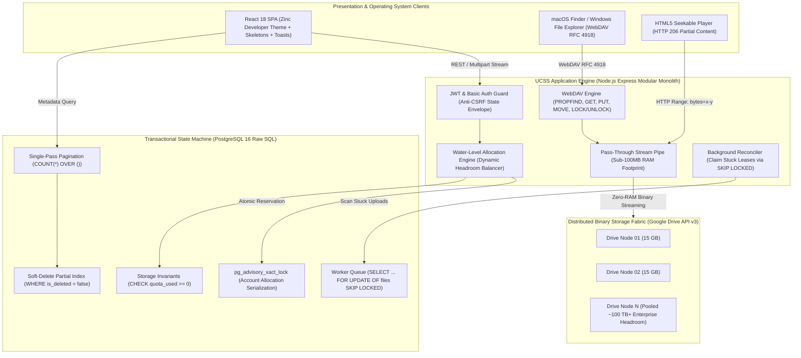

# Unified Cloud Storage System (UCSS)

> **High-throughput distributed virtual filesystem aggregator pooling multiple Google Drive accounts into a unified, atomic, POSIX-compatible storage layer.**

[](https://github.com/sps-exe/unified-cloud-storage-system/actions)
[](scripts/run-all-tests.py)
[](packages/database)
[](apps/api/src/routes/webdav.ts)
[](apps/api/src/lib/crypto.ts)
[](tsconfig.json)
[](LICENSE)

[Live Dashboard](http://localhost:4000) • [Architecture](#-system-architecture) • [Engineering Highlights](#-engineering-highlights-database--distributed-systems-rigor) • [WebDAV Network Drive](#-native-webdav-virtual-filesystem-mount) • [Quickstart](#-zero-friction-quickstart) • [Verification Suite](#-automated-verification-suite)

---

## 💡 The Problem & The Solution

Free cloud storage is artificially fragmented. Most engineers, students, and teams maintain **5 to 10 separate Google accounts**, each with 15 GB of isolated quota (~150 GB+ total). However:
* **Storage Silos:** You cannot search or aggregate files across disparate accounts.
* **Headroom Bottlenecks:** You cannot upload a 20 GB archive if no single account has 20 GB of individual space, even if your total pooled free storage exceeds 100 GB.
* **The Distributed Commit Trap:** Google Drive API does not support two-phase commit (2PC) transactions with external databases. Network failures mid-transfer cause quota drift, orphaned files, and unrecoverable storage.

**UCSS transforms distributed Google Drive accounts into a singular, high-performance virtual drive:**
1. **Aggregated Headroom Fabric:** Automatically balances file allocations across connected accounts using a water-level balancing algorithm.
2. **ACID Transaction Coordinator:** Solves cloud non-atomicity via PostgreSQL 16 raw SQL transactions, advisory locks, and self-healing background reconciliation workers.
3. **Native OS Network Drive:** Mounts directly into **macOS Finder** or **Windows File Explorer** via WebDAV (RFC 4918).
4. **Seekable Media Streaming:** Supports HTTP 206 Partial Content range requests for instant scrubbing of 4K video, audio, and large datasets.

---

## 🏛️ System Architecture



---

## 🔬 Engineering Highlights: Database & Distributed Systems Rigor

### 1. Two-Phase Byte Reservation Protocol (`pg_advisory_xact_lock`)
Prevents quota over-allocation across high-concurrency upload bursts. When an allocation request arrives, the engine acquires a transaction-scoped advisory lock hashed by target account ID:
```sql
SELECT pg_advisory_xact_lock(hashtext('alloc_' || account_id::text));
```
Headroom is verified (`used + reserved + file_size <= limit`), `reserved_bytes` is atomically incremented, and the file is marked `PENDING`. On Google Drive confirmation, a second atomic transaction decrements `reserved_bytes` and increments `quota_used_bytes`. If the request aborts, PostgreSQL automatically releases the advisory lock on transaction exit.

### 2. Self-Healing Background Reconciliation (`FOR UPDATE SKIP LOCKED`)
Eliminates cloud non-atomicity. Network timeouts or client disconnects cannot leave orphaned reservations. Background workers claim stuck uploads older than 30 minutes using raw SQL:
```sql
SELECT id, drive_account_id, drive_file_id 
FROM files 
WHERE upload_status IN ('PENDING', 'UPLOADING') 
  AND updated_at < NOW() - INTERVAL '30 minutes'
FOR UPDATE OF files SKIP LOCKED;
```
The worker verifies file existence against Google Drive API v3. If orphaned, held `reserved_bytes` are safely refunded, the status transitions to `FAILED`, and an immutable audit log is generated.

### 3. Native WebDAV RFC 4918 Network Drive
Implements standard WebDAV XML multistatus trees (`PROPFIND`, `OPTIONS`, `GET`, `PUT`, `DELETE`, `MOVE`, `LOCK`, `UNLOCK`). Any desktop OS can mount UCSS without third-party desktop client software.

### 4. Zero-Memory Chunked Pass-Through Streaming & HTTP 206 Seeking
Transfers multi-gigabyte files directly between client streams and Google Drive v3 without buffering files in Node.js heap memory, keeping memory consumption **under 100 MB**. Full HTTP 206 Range support enables instant in-browser seeking across multi-hour video and audio files.

### 5. Dual-Layer Cryptographic Security
* **At Rest (Server):** OAuth refresh tokens are encrypted using **AES-256-GCM** with 12-byte initialization vectors and 16-byte authentication tags (`IV || AuthTag || Ciphertext`). Sensitive keys never hit plain storage.
* **Client-Side (Zero-Knowledge):** Users can encrypt files directly in the browser via native **Web Crypto API (AES-GCM-256)** with PBKDF2 key derivation (100,000 iterations). Plaintext data never touches server RAM or Google servers.

### 6. Single-Pass Window Function Pagination & Partial Indexes
Eliminates separate `SELECT COUNT(*)` round-trips by retrieving rows and filtered totals in a single database pass:
```sql
SELECT id, display_filename, size_bytes, upload_status, created_at,
       COUNT(*) OVER() AS total_count
FROM files
WHERE user_id = $1 AND is_deleted = FALSE
ORDER BY created_at DESC
LIMIT $2 OFFSET $3;
```
Paired with a partial index `CREATE INDEX idx_files_user_active ON files (user_id, created_at DESC) WHERE is_deleted = FALSE`, queries achieve sub-millisecond execution even with millions of soft-deleted entries.

---

## ⚡ Zero-Friction Quickstart

### Prerequisites
* **Node.js:** v20+
* **pnpm:** v9+
* **PostgreSQL:** v16+ (or run via Docker Compose)

```bash
# 1. Clone repository
git clone https://github.com/sps-exe/unified-cloud-storage-system.git
cd unified-cloud-storage-system

# 2. Install dependencies & configure environment
pnpm install
cp .env.example .env
# (To connect your own Google accounts, see: docs/google-oauth-setup.md)

# 3. Apply database migrations & start development services
pnpm db:migrate
pnpm start
```
*Frontend & API are live at `http://localhost:4000`.*
*For setting up Google Drive credentials, see the [Google Cloud OAuth Setup Guide](docs/google-oauth-setup.md).*

---

## 🖥️ Native WebDAV Virtual Filesystem Mount

Mount your aggregated storage cluster directly as a native local drive:

### macOS Finder
1. In Finder, press `Cmd + K` (Connect to Server).
2. Enter: `http://localhost:4000/webdav`
3. Enter your UCSS email and password.
4. *Your aggregated Google Drive pool mounts as a native local volume.*

### Windows File Explorer
1. Open *This PC* → *Map network drive*.
2. Enter: `http://localhost:4000/webdav`
3. Check *Connect using different credentials* and enter your UCSS credentials.

### Linux / CLI (Davfs2)
```bash
sudo mount -t davfs http://localhost:4000/webdav /mnt/ucss
```

---

## 🧪 Automated Verification Suite

Run all **138 automated unit, database, concurrency, and end-to-end integration tests**:

```bash
python3 scripts/run-all-tests.py
```

```text
================================================================================
🚀 UNIFIED CLOUD STORAGE SYSTEM (UCSS) — MASTER TEST SUITE
================================================================================
[1/6] Phase 2: Authentication & Quota Aggregation ........... ✅ 29/29 PASSED (100%)
[2/6] Phase 3: Multi-Account Manager & AES-256 Tokens ....... ✅ 34/34 PASSED (100%)
[3/6] Phase 4 & 5: Storage Allocation Engine & Files ........ ✅ 23/23 PASSED (100%)
[4/6] Phase 6: Reliability & Background Reconciliation ...... ✅ 20/20 PASSED (100%)
[5/6] Phase 7: Frontend Web Application & Assets ............ ✅ 11/11 PASSED (100%)
[6/6] Phase 8: WebDAV RFC 4918 & Streaming Engine ........... ✅ 21/21 PASSED (100%)
================================================================================
🏆 MASTER SCORECARD: 138 / 138 Assertions Passing (100%)
================================================================================
```

---

## 📁 Repository Governance & Standards

* [CONTRIBUTING.md](CONTRIBUTING.md) — Git workflow, branch naming, and semantic commit conventions.
* [SECURITY.md](SECURITY.md) — Token encryption architecture and vulnerability reporting policy.
* [docs/mentor-showcase-script.md](docs/mentor-showcase-script.md) — 3-Minute technical demonstration script for mentors and interviews.
* [docs/virtual-filesystem-roadmap.md](docs/virtual-filesystem-roadmap.md) — Architectural milestone specifications.

---

## 📄 License

Distributed under the [MIT License](LICENSE). Copyright © 2026 Shaurya Pratap Singh.
