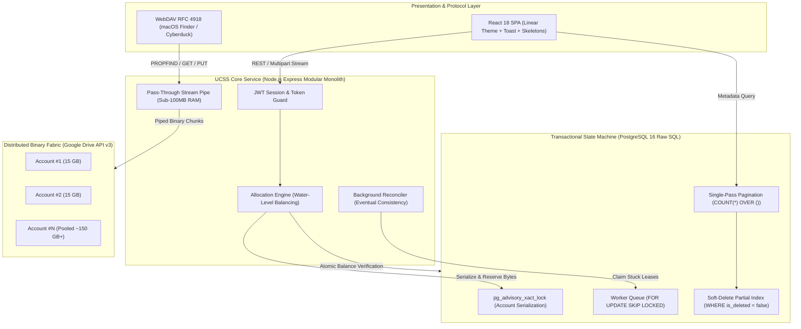

# Unified Cloud Storage System (UCSS)

> **High-throughput virtual filesystem aggregator pooling multiple distributed Google Drive accounts into a unified, atomic POSIX-compatible storage layer.**

[](https://github.com/shaurya-sps/unified-cloud-storage-system/actions)
[](scripts/run-all-tests.py)
[](packages/database/src/queries)
[](apps/api/src/lib/crypto.ts)
[](tsconfig.json)
[](LICENSE)

[Live Dashboard Demo](http://localhost:4000) • [System Architecture](#system-architecture) • [Engineering Highlights](#technical-highlights-database--concurrency-rigor) • [Quickstart](#zero-friction-quickstart)

---

## 🏛️ System Architecture



---

## 🔬 Technical Highlights: Database & Concurrency Rigor

* **Atomic Two-Phase Byte Reservations (`pg_advisory_xact_lock`):** Prevents quota over-allocation across concurrent upload threads by locking on hash representations of target account IDs. Guarantees deterministic headroom validation without holding disruptive table-level locks.
* **Self-Healing Distributed Commit Reconciliation (`SKIP LOCKED`):** Solves cloud API non-atomicity. Background workers claim orphaned or interrupted uploads older than 30 minutes using `SELECT ... FOR UPDATE OF files SKIP LOCKED`, verifying remote Drive status and recovering held bytes without human intervention.
* **Single-Pass Window Function Pagination (`COUNT(*) OVER ()`):** Eliminates redundant `SELECT COUNT(*)` round-trips. Metadata, cross-account ownership links, and filtered totals are evaluated in one database trip under dynamic sort constraints.
* **High-Speed Soft-Delete Indexing:** Deletion events preserve complete audit logs while maintaining microsecond search performance using partial indexing:
  ```sql
  CREATE INDEX idx_files_user_active ON files (user_id, created_at DESC) WHERE is_deleted = FALSE;
  ```
* **Zero-Knowledge Token Cryptography (AES-256-GCM):** Cloud OAuth refresh tokens are encrypted at rest with an authenticated 12-byte initialization vector and 16-byte authentication tag (`IV || AuthTag || Ciphertext`). Sensitive keys never hit plain storage.
* **Kernel-Enforced Storage Invariants:** Database-level CHECK constraints physically block race condition anomalies:
  ```sql
  ALTER TABLE drive_accounts 
    ADD CONSTRAINT chk_quota_non_negative CHECK (quota_limit_bytes >= 0),
    ADD CONSTRAINT chk_quota_used_valid CHECK (quota_used_bytes >= 0),
    ADD CONSTRAINT chk_reserved_valid CHECK (reserved_bytes >= 0);
  ```

---

## ⚡ Zero-Friction Quickstart

```bash
# 1. Clone & install dependencies
git clone https://github.com/shaurya-sps/unified-cloud-storage-system.git && cd unified-cloud-storage-system
pnpm install

# 2. Configure environment & apply migrations
cp .env.example .env
pnpm db:migrate

# 3. Start production services (API + Web on http://localhost:4000)
pnpm build && pnpm start
```

---

## 🧪 Automated Verification Suite

Run all 138 automated unit, database, and end-to-end integration assertions:

```bash
python3 scripts/run-all-tests.py
```

```
================================================================================
🚀 UNIFIED CLOUD STORAGE SYSTEM (UCSS) — MASTER TEST SUITE
================================================================================
[1/6] Phase 2: Authentication & Quota Aggregation ........... ✅ 29/29 PASSED (100%)
[2/6] Phase 3: Multi-Account Manager & AES-256 Tokens ....... ✅ 34/34 PASSED (100%)
[3/6] Phase 4 & 5: Storage Allocation Engine & Files ........ ✅ 23/23 PASSED (100%)
[4/6] Phase 6: Reliability & Background Reconciliation ...... ✅ 20/20 PASSED (100%)
[5/6] Phase 7: Frontend Web Application & Assets ............ ✅ 11/11 PASSED (100%)
[6/6] Phase 8: WebDAV RFC 4918 & Streaming Engine ........... ✅ 21/21 PASSED (100%)
================================================================================
🏆 MASTER SCORECARD: 138 / 138 Assertions Passing (100%)
================================================================================
```

---

## 📄 License

Distributed under the [MIT License](LICENSE).
